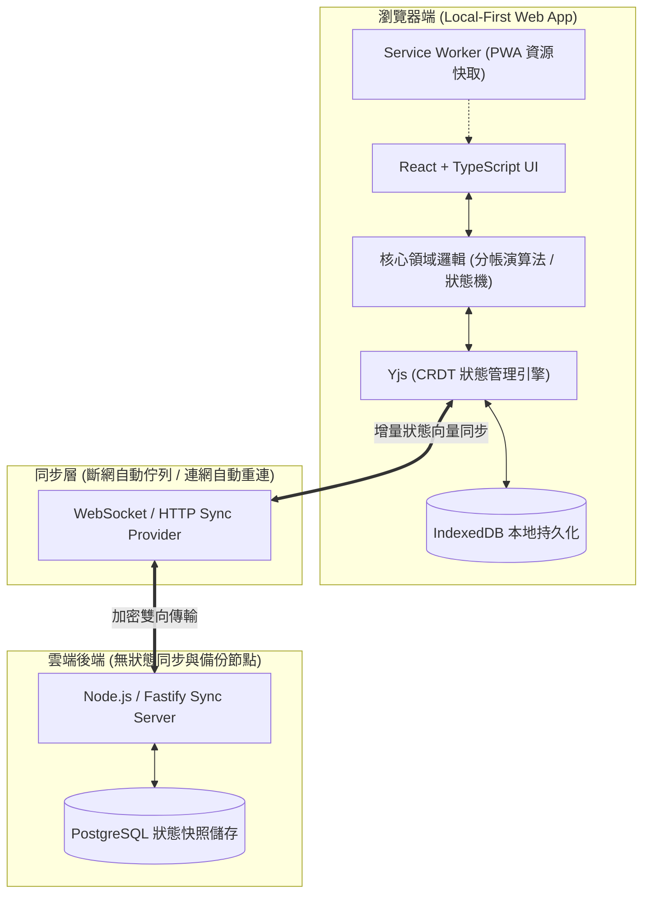

# SyncTrip — Local-First 離線優先多人旅遊協作與分帳平台

> **現代軟體工程期末專案（Solo Developer + AI-Assisted Workflow）**
>
> 打破傳統網頁應用「斷網即癱瘓」的限制，打造即使在飛機上、地鐵裡或海外網路不穩時，依然能 **0ms 零延遲操作**、並在恢復連線後**自動無衝突合併多人編輯**的現代化網頁應用程式。

## 📖 1. 專案背景與解決痛點

傳統的雲端協作與分帳網站高度依賴即時網路請求（Request-Response），在實際旅遊場景中常面臨以下問題：

1. **網路不穩導致體驗卡頓：** 在國外漫遊、地下室或山區時，每次新增一筆花費都要等待轉圈圈（Loading），甚至因請求逾時而遺失資料。
2. **離線編輯衝突（Data Conflict）：** 當兩位旅伴在無網路狀態下各自修改同一份行程或帳目，重新連網時容易發生「後寫覆蓋前寫（Last-Write-Wins）」的資料覆蓋災難。

**SyncTrip 的解法：** 採用 **Local-First（離線優先）** 軟體架構，將瀏覽器本地資料庫作為「單一事實來源（Single Source of Truth）」，搭配無衝突複製資料類型（CRDTs）演算法，實現真正的離線可用與多端最終一致性（Eventual Consistency）。

## ✨ 2. 核心功能亮點

* **⚡ 0ms 零延遲本地讀寫：** 所有 UI 操作直接讀寫瀏覽器內建的 IndexedDB，完全不等待後端 API 回應。
* **✈️ 完整離線運作（PWA）：** 透過 Service Worker 快取靜態資源，支援安裝至手機／電腦桌面；即使完全斷網或重新整理網頁，依然可正常瀏覽與編輯。
* **🔄 無衝突狀態同步引擎（CRDT Sync）：** 基於 Yjs 實作狀態同步，支援多人同時在離線狀態下修改同一份行程表與帳單，恢復連線後自動合併變更，資料一筆不漏。
* **💸 智慧複雜分帳與債務簡化演算法：**
  * 支援多幣別即時換算（離線時自動套用最近一次快取匯率）。
  * 支援「指定成員分攤」、「按比例／金額拆帳」與「多對多墊付」。
  * 內建**最小現金流演算法（Minimum Cash Flow Algorithm）**，將複雜的網狀欠款關係化簡為最少的轉帳次數（時間複雜度優化至 $O(N \log N)$）。

## 🏗️ 3. 系統架構與技術選型

### 系統架構圖



### 技術棧與軟體工程考量

| 層級 | 選用技術 | 工程決策理由 |
| :--- | :--- | :--- |
| **前端框架** | React 19 + TypeScript + Vite | 強型別系統能在單人開發時充當第一道防線，大幅降低 AI 生成程式碼時的介面溝通錯誤。 |
| **本地儲存與同步** | Yjs + `y-indexeddb` + `y-websocket` | 業界驗證成熟的 CRDT 實作，避免重複造輪子並確保分散式資料一致性。 |
| **離線快取** | Vite PWA Plugin (Workbox) | 自動生成 Service Worker 策略，確保離線資源載入可靠性。 |
| **後端服務** | Node.js (Fastify) + PostgreSQL | 輕量高併發，負責房間權限驗證與 CRDT 二進位狀態持久化備份。 |
| **測試框架** | Vitest + Playwright | 兼顧純演算法單元測試，以及瀏覽器離線模式（Offline Mode）端對端測試。 |

## 🤖 4. 現代軟體工程實踐（一人全端與 AI 品質護欄）

在單人全端開發過程中，為了避免因缺乏同儕 Code Review 而導致系統架構失控或產生 AI 幻覺程式碼，本專案建立了一套**可驗證、自動化的現代軟體工程工作流**：

1. **規格驅動開發（Spec-Driven Development）：**
   * 所有功能在進入寫碼前，皆先撰寫結構化規格書（位於 `/docs/specs/`），明確定義資料結構（Schema）、狀態轉換與邊界條件，再引導 AI 依規格分模組實作。
2. **版本控制的 AI 開發規範（`.cursorrules` / `CLAUDE.md`）：**
   * 在專案根目錄維護 AI 系統提示詞與架構約束檔，強制規定「核心分帳與 CRDT 邏輯必須與 React UI 層完全解耦（Pure Functions）」，確保單人也能維持高內聚、低耦合的程式碼品質。
3. **自動化測試與 CI 守門員：**
   * **單元測試（Unit Tests）：** 針對分帳精度（避免浮點數誤差）、多幣別換算與債務簡化演算法撰寫完整測試案例。
   * **離線混沌測試（Offline E2E Tests）：** 利用 Playwright 模擬「雙開瀏覽器視窗 $\rightarrow$ 切斷其中一方網路 $\rightarrow$ 雙方同時修改同一筆帳目 $\rightarrow$ 恢復網路」的極端情境，驗證最終資料 $100\%$ 一致。
   * **CI/CD 流水線：** 透過 GitHub Actions 在每次 Commit / Push 時自動執行型別檢查（Typecheck）、Lint 與全套自動化測試，取代人工審查盲點。

## 📂 5. 專案目錄結構

```text
synctrip/
├── .github/workflows/       # GitHub Actions CI/CD 自動化測試流程
├── docs/                    # 產品需求規格書 (PRD)、架構決策紀錄 (ADR)
├── src/
│   ├── core/                # [純邏輯層] 不依賴任何框架與瀏覽器 API
│   │   ├── split-engine/    # 複雜分帳計算與債務簡化演算法
│   │   └── models/          # TypeScript 核心資料模型與驗證 Schema
│   ├── sync/                # [資料同步層] Yjs 文件定義、IndexedDB 綁定與網路狀態偵測
│   ├── ui/                  # [表現層] React 元件、離線狀態指示器、頁面路由
│   └── main.tsx             # 應用程式進入點與 Service Worker 註冊
├── tests/
│   ├── unit/                # 核心分帳演算法單元測試 (Vitest)
│   └── e2e/                 # 多人離線衝突合併模擬測試 (Playwright)
├── server/                  # 輕量級 WebSocket 同步與快照備份伺服器
├── CLAUDE.md                # AI 協作規範與架構約束指引
└── README.md
```

## 🚀 6. 快速開始與離線 Demo 指南

### 環境需求

* Node.js `>= 20.0.0`
* pnpm `>= 9.0.0` (或 npm / yarn)

### 本地啟動步驟

```bash
# 1. 複製專案儲存庫
git clone https://github.com/<your-username>/synctrip.git
cd synctrip

# 2. 安裝前後端相依套件
pnpm install

# 3. 同時啟動本地同步伺服器與前端開發環境
pnpm dev
```

### 執行自動化測試（含離線衝突模擬）

```bash
# 執行核心分帳演算法單元測試
pnpm test:unit

# 執行 Playwright 端對端離線同步測試
pnpm test:e2e
```

### 🎭 課堂 Demo 測試腳本（如何驗證 Local-First 特性）

1. 開啟兩個瀏覽器視窗（例如 Chrome 正常視窗與無痕視窗），進入同一個旅遊行程房間。
2. 在**視窗 A** 打開 DevTools (`F12`) $\rightarrow$ `Network` 分頁 $\rightarrow$ 將網路狀態切換為 **`Offline`**。
3. 在斷網的**視窗 A** 新增一筆花費「居酒屋晚餐 ¥12,000」；同時在連網的**視窗 B** 新增「新幹線車票 ¥28,000」並修改行程時間。
4. 觀察**視窗 A** 介面完全無延遲、正常更新結算金額，且頂部顯示「離線模式（待同步變更：1 筆）」。
5. 將**視窗 A** 網路切回 **`No throttling`**，觀察兩邊視窗在 1 秒內自動完成資料合併，且所有成員的應收／應付金額完全一致。

## 👤 7. 作者資訊

* **開發者：** `[你的姓名 / 學號]`
* **角色定位：** 系統架構設計、規格定義、AI 協作工作流建置與全端開發

## 📄 授權條款

本專案採用 [MIT License](LICENSE) 授權。